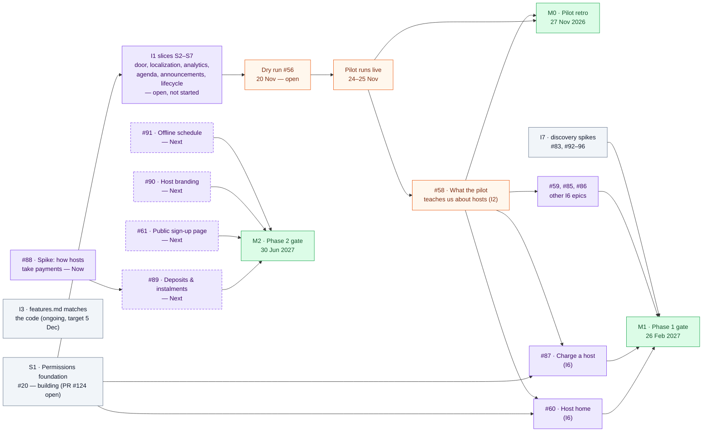
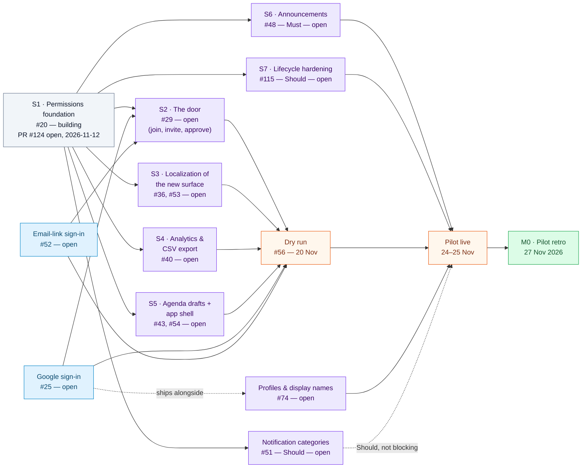

# Dependency map

> **Status: living, first version.** Opened 2026-11-13. Covers the **Now** and **Next** horizon
> (tracker.md's own scale, not a new one). **Later** work (I4) and closed work (I5) are named only
> where they clarify a boundary. This file is the authoritative source — see "Board format and
> persistence" below.

## Purpose

A backward-built dependency network: what must be true before each active delivery milestone counts
as delivered, and what can run in parallel. It is not a screen-flow diagram, not an architecture
diagram, and not the backlog hierarchy — [tracker.md](tracker.md) still owns the three levels
(Initiative → Epic → Story/Task/Bug/Spike) and [pipeline.md](pipeline.md) still owns who runs what.
This file answers one question none of those do: **in what order does this actually have to happen,
and where is it stuck?**

## Framing

- **Active scope:** every initiative at Horizon Now or Next, as GitHub's own Horizon field and
  tracker.md record them: **I1, I2, I3, I6, I7 (Now), I8 (Next)**. I4 (Later) and I5 (closed,
  2026-11-10) are shown only as boundary references.
- **Milestones in the active horizon:** M0 Pilot retro (2026-11-27), M1 Phase 1 gate (2027-02-26), M2
  Phase 2 gate (2027-06-30) — dates and gate criteria from [tracker.md](tracker.md), "Milestones".
- **Nearest deadline:** the pilot itself runs **24–25 Nov 2026**, eleven days from today
  (2026-11-13). The dry run is **20 Nov**, seven days out.
- **[assumption]** Where tracker.md's slice table names an epic but a dependency between it and
  another initiative's epic is not written down anywhere, I have drawn the arrow only when an
  issue's own body states it, and otherwise left it as an open question rather than invent it. Every
  arrow below is traceable to one of: spec 012 §12 ("S1 before everything. S2 and S3 run together."),
  spec 002 §14 Build status, or a specific issue body quoted in the register. Where I inferred a
  prerequisite that is not written anywhere (for example, that joining a trip needs a way to sign in
  first), it is marked **[assumption]** in the register, not drawn as a certainty.
- **What I could not verify:** Horizon and Priority are GitHub Projects v2 custom fields, which this
  session can only read through GraphQL — blocked here with "GitHub GraphQL is not available from
  Claude Code sessions." I have used tracker.md's own written record of Horizon (I1/I2/I3/I6/I7 Now,
  I8 Next) as ground truth instead of the live board, and each issue's own **Horizon:** line in its
  body where the issue itself carries one (several do, see the register — one of them, #88, disagrees
  with its own initiative and is flagged below). If the live board has moved since tracker.md was last
  updated (2026-11-13), this file is behind it until someone reconciles the two.

## Board format and persistence

**How wireframes already work here**, per `wireframes/*/README.md` and
[docs/README.md](../README.md) rule 7: a set of plain, self-contained HTML files committed to git —
`artboards/*.dc.html` as the editable source, `canvas.json` for layout, and a generated `index.html`
as the single thing someone actually opens, in any browser, no build and no account. The repo is the
only thing that syncs between the two Claude accounts (D26), so the committed file *is* the board —
there is no separate hosted whiteboard to keep in sync with it.

**This file follows the same shape**, adapted to a dependency map instead of a set of screens:

| | Wireframes | This dependency map |
|---|---|---|
| Editable source | `artboards/*.dc.html` + `canvas.json` | The Mermaid code block below, plus the register table, both in this one markdown file |
| Generated view | `index.html` | [`dependency-map/index.html`](dependency-map/index.html) — same diagrams, rendered with Mermaid's own script, regenerated by hand whenever the blocks below change |
| Who edits it | Either account, via `scripts/docs-commit.sh` | Same |
| What's authoritative | The artboards | **This file.** The generated HTML is a view, never edited directly — if it ever disagrees with this file, this file wins |

I did not use Claude's own Artifact/Whiteboard tool for this. It is an option in general, but it would
put the authoritative version in a hosted artifact tied to one Claude account, which is exactly what
rule 7 and D26 exist to avoid for anything that has to survive across the two accounts and computers.
A screenshot of either rendering is a snapshot for a chat message, never a second master.

**Where the authoritative content lives:** `docs/process/dependency-map.md` (this file), on `main`
once its PR merges, same as every other process doc.

**How it is reopened and updated:** open this file in any session on either account. GitHub also
renders the Mermaid blocks natively in its own file view, so reading it needs nothing beyond a
browser even before anyone opens the generated HTML. To change it: edit the Mermaid block and/or the
register, regenerate `dependency-map/index.html` if the diagram changed, and commit both through
`scripts/docs-commit.sh` like any other docs change (ww-D6, ww-D13).

**Mermaid rendering:** direct, in both places — GitHub's own markdown preview renders the fenced
` ```mermaid ` blocks below with no extra step, and `dependency-map/index.html` renders the identical
source with `mermaid.min.js` from a CDN, the same trade-off the wireframes' README already accepts
for its webfont. Nothing here uses Mermaid to *generate* a different board format.

**Clicking through to GitHub.** Every node below carries a Mermaid `click` directive to its issue or
milestone. **This only activates where Mermaid's own script runs the diagram** —
`dependency-map/index.html`, or pasting a block into the [Mermaid Live Editor](https://mermaid.live).
**GitHub's markdown preview sanitizes `click` out of embedded Mermaid for security and will not make
the boxes clickable there**, even though the same source renders the shapes and colors correctly. So
the generated HTML page is the one to open when you want to click through, not the GitHub file view.

**Keeping the picture and the register in sync:** they are sections of the same file, so there is
exactly one place to edit and one commit changes both. There is no separate sync mechanism to build
or maintain — that is deliberate, per the instruction not to build new synchronization machinery for
this artifact.

## Legend

| Shape fill | Category |
|---|---|
| 🩶 slate | Foundational decision/prerequisite that several things route through |
| 🔵 blue | Identity / cross-cutting foundation (sign-in) |
| 🟣 purple | Feature delivery (an epic or slice) |
| 🟠 orange | Verification / gate (dry run, the pilot itself, a spike whose output is a decision) |
| 🟢 green | Milestone |

| Border | Horizon |
|---|---|
| Solid | Now |
| Dashed | Next |

Status (open / building / done) is written inside the node label, since this board has only two
people and no work currently "blocked" in the formal sense — a stalled item shows up as "open" with
an old date in the register instead of a third visual state.

## 1. Overview — initiatives across the active horizon



**I3 is drawn unconnected on purpose.** "`features.md` matches the code" is real, Now-horizon work
([tracker.md](tracker.md) I3), but nothing in the active scope has a completion dependency on it, and
it depends on nothing here either — it is parallel quality debt, not on a path to any milestone. A
disconnected node that should not be connected is still worth showing, so it is not mistaken for
something I forgot.

**Checked and clear:** no Now or Next item in this map depends on anything classified **Later** (I4,
transport delay alerts) or on the closed I5. If that changes — for example if a premium-host epic
ever needed transport data — it would show up here as a dependency crossing the active boundary, per
the instruction to surface that rather than hide it.

## 2. Detail — I1, the pilot MVP (Now, M0, due 24–25 Nov)

This is the one part of the active scope with a real, written dependency rule
([spec 012](../specs/012-joining-naming-and-the-first-trip.md) §12: *"S1 before everything. S2 and S3
run together. S4 must land before the dry run on 20 Nov."*), real issue numbers, and — as of
2026-11-13 — almost nothing built yet. It is also the nearest deadline in the whole map, so it gets
its own view rather than living only inside the overview's one collapsed node.



**Reading this one:** every Must-priority box upstream of `LIVE` has to be done for the pilot to run
as designed. Today, only S1 has started (one open pull request), and S4 — the one slice spec 002 §14
names explicitly as a hard deadline before the dry run — has not. `S6b` (notification categories) is
Should, not Must, so it is drawn as an optional feed into the live event, not a blocker.

## Register

Evidence as read from `gh api` against `Fogataz/trip-planner` and the docs below, 2026-11-13. "Open,
no update since…" means the issue has had no commits or PR activity since the date shown — not that
it is stuck, just that nothing here says otherwise.

### I1 · Run the hosted event pilot (#19) — Now, M0, 24–25 Nov

| ID | Work package | Epic/issue | Now/Next | Status & evidence | Direct prerequisites | Completion criteria | Spec / wireframes |
|---|---|---|---|---|---|---|---|
| S1 | Permissions foundation | [#20](https://github.com/Fogataz/trip-planner/issues/20) | Now | **Building.** PR [#124](https://github.com/Fogataz/trip-planner/pull/124) open since 2026-11-12, 49 files changed, not merged, `mergeable_state: dirty` as of this read | None | Capability table and `can()` helper exist; `TripMember`/`OrgMember` migration runs with a dry-run and a reverse path; G3 (no self-demotion), G4 (immediate revocation), G5 (one helper) hold; role labels per §5.3; `Trip.entitlement` reserved (R8) | [011](../specs/011-roles-and-permissions.md), [012](../specs/012-joining-naming-and-the-first-trip.md) §12 |
| — | Google sign-in | [#25](https://github.com/Fogataz/trip-planner/issues/25) | Now | Open, no PR found | None | `POST /api/auth/firebase` verifies the ID token and returns our JWT; email/password keeps working for existing accounts ([#26](https://github.com/Fogataz/trip-planner/issues/26), [#27](https://github.com/Fogataz/trip-planner/issues/27), [#28](https://github.com/Fogataz/trip-planner/issues/28)) | spec 002 §5, §7 |
| — | Email-link sign-in | [#52](https://github.com/Fogataz/trip-planner/issues/52) | Now | Open, no PR found | None | A join by email link can sign in without a password | spec 002 |
| S2 | The door (join, invite, approve) | [#29](https://github.com/Fogataz/trip-planner/issues/29) | Now | Open; sub-issues [#30](https://github.com/Fogataz/trip-planner/issues/30)–[#35](https://github.com/Fogataz/trip-planner/issues/35) all open | S1 **[spec-stated]**; Google/email sign-in **[assumption — joining needs an identity]** | Host creates/copies/revokes one active link; join page shows name, dates, host, cover; signed-in visitor can request; host approves/declines inc. "Approve all"; a pending requester gets nothing until approved; email-invited people skip approval | [002](../specs/002-hosted-event-pilot.md), [012](../specs/012-joining-naming-and-the-first-trip.md) §5.8–5.9; wireframes [012 set](../../wireframes/012-joining-and-naming/index.html) frames 1–5, 8–12 |
| S3 | Localization of the new surface | [#36](https://github.com/Fogataz/trip-planner/issues/36), [#53](https://github.com/Fogataz/trip-planner/issues/53) | Now | Both open | S1 **[spec-stated]**. Runs *with* S2, not after it | Every new screen ships en/es/pt; times show in the event zone via `Intl`; the join page works logged out in the visitor's language; language saved to the account; push localized; CI missing-key check | 012 §6; wireframes 012 set frame 13 |
| S4 | Analytics events & CSV export | [#40](https://github.com/Fogataz/trip-planner/issues/40) | Now | Open — **spec 002 §14 names this the one hard pre-dry-run deadline** | S1 | The 17 pilot events record with pseudonymous ids, no content; CSV export per trip for the retro; the 4 invited-path events and the two separate funnels (012 §5.9.1) exist | spec 002 §7, §11; 012 §5.9.1 |
| S5 | Agenda drafts + app shell | [#43](https://github.com/Fogataz/trip-planner/issues/43), [#54](https://github.com/Fogataz/trip-planner/issues/54) | Now | Both open. #54 retitled and raised Must on 2026-11-13 (tracker.md) | S1 | Agenda import by paste/upload; AI draft with confidence flags; host reviews/edits/publishes/discards; drafts stay in source language; on the target phones the installed app has no browser chrome, usable in-app nav, no accidental pinch-zoom (open question on exact mechanism — see below) | spec 002 §6, §7; tracker.md "2026-11-13: row 11 split" |
| S6-Must | Announcements with pin/unread | [#48](https://github.com/Fogataz/trip-planner/issues/48) | Now | Open | S1 | Host posts/pins/unpins/deletes; announcements appear live with per-member unread state | spec 002 §7 |
| S6-Should | Notification categories | [#51](https://github.com/Fogataz/trip-planner/issues/51) | Now (Should cut line) | Open | S1 | Per-category opt-out exists (F27–F29) | spec 002 F27–F29 |
| S7 | Lifecycle hardening | [#115](https://github.com/Fogataz/trip-planner/issues/115) | Now (Should cut line) | Open | S1 | A trip can never be left with no host, an Organization never with no owner (G1 last host, G2 last owner) | [011](../specs/011-roles-and-permissions.md) §6.2; wireframes 012 set frames 6–7 |
| — | Profiles & display names | [#74](https://github.com/Fogataz/trip-planner/issues/74) | Now, M0 | Open. Its own text says it ships "alongside" Google sign-in | Google sign-in (#25) **[assumption — "alongside" read as a soft sequencing note, not a hard block]** | Names and avatars replace email addresses | spec 007 (draft seed) |
| — | Dry run | [#56](https://github.com/Fogataz/trip-planner/issues/56) | Now | Open, 20 Nov | S2, S3, S4 **[spec-stated for S4]**; S5 (#54 install), Google + email sign-in **[assumption, from #56's own test matrix: personal Google account, work-mailbox email link, iPhone, Android, all 3 languages]** | A personal Google account, a work-mailbox email link, an iPhone and an Android device, all three languages, all complete the join flow | spec 002 §12 step 4 |
| — | Pilot live | — | Now | Scheduled, 24–25 Nov | Dry run; S6-Must; S7 | The event runs on Trip Planner; the 11 signals in spec 002 §11 are captured (join rate ≥ 60%, etc.) | spec 002 §11 |
| M0 | Pilot retro | milestone, due 2026-11-27 | Now | Not yet due | Pilot live; #58 spike | Verdict against the working-doc §5 thresholds ([tracker.md](tracker.md) "Milestones") | working-doc §5 |

### I2 · Learn from the pilot and keep offsites as a benchmark (#57) — Now, M0

| ID | Work package | Epic/issue | Now/Next | Status | Direct prerequisites | Completion criteria | Reference |
|---|---|---|---|---|---|---|---|
| — | Spike: what the pilot teaches us about hosts | [#58](https://github.com/Fogataz/trip-planner/issues/58) | Now | Open | Pilot live (its own done-when is a retro against pilot metrics) **[issue-stated]** | Retro against spec 002 §11 signals; pilot metrics recorded as the host benchmark; **a list of changes for briefs 3–7** | epic-briefs.md brief 2 |

### I3 · What we have built works as documented (#62) — Now, no milestone, target 5 Dec

Parallel quality debt. Not drawn with arrows into the active-horizon diagrams above (see "I3 is drawn
unconnected on purpose").

| ID | Work package | Epic/issue | Status | Reference |
|---|---|---|---|---|
| — | Settle up: record a payment | [#63](https://github.com/Fogataz/trip-planner/issues/63) | Open | spec 005 (draft seed) |
| — | Real-time gaps: Q&A events, accommodation listeners | [#64](https://github.com/Fogataz/trip-planner/issues/64) | Open | working-doc §4.1 item 7 |
| — | Activity coverage and read state | [#65](https://github.com/Fogataz/trip-planner/issues/65) | Open | spec 008 (draft seed) |
| — | Remove duplicate Mongoose indexes | [#66](https://github.com/Fogataz/trip-planner/issues/66) | Open | roadmap, next priority 5 |
| — | Fix Redis URL configuration | [#67](https://github.com/Fogataz/trip-planner/issues/67) | Open | roadmap, next priority 5 |
| — | Hosting + rollback steps (ww-D3) | [#99](https://github.com/Fogataz/trip-planner/issues/99) | Open, TBD on purpose until after the pilot | ways-of-working.md §4 |

### I6 · Premium hosts run a repeat departure without our help (#82) — Now, M1, 26 Feb 2027

| ID | Work package | Epic/issue | Now/Next | Status | Direct prerequisites | Completion criteria | Reference |
|---|---|---|---|---|---|---|---|
| — | Hosts have every traveller's details before departure | [#59](https://github.com/Fogataz/trip-planner/issues/59) | Now | Open, no spec yet | #58 (its scope is one of "briefs 3–7") **[issue-stated]** | 90% complete forms 7 days out with no host chasing | epic-briefs brief 3 |
| — | Host home — all departures in one place | [#60](https://github.com/Fogataz/trip-planner/issues/60) | Now | Open, no spec yet | S1 **[the epic's own stories operate on "my business"/Organization, which S1 creates — assumption]**; #58 | Hosts open a weekly home showing readiness per departure; add a co-host; set business defaults once; see plan/invoices | epic-briefs brief 5 |
| — | Duplicate a departure | [#85](https://github.com/Fogataz/trip-planner/issues/85) | Now | Open, no spec yet | #58 | Median setup time of a second departure under 30 minutes | epic-briefs brief 4 |
| — | Optional activities & sub-groups | [#86](https://github.com/Fogataz/trip-planner/issues/86) | Now | Open, no spec yet | #58 | Optional items fill through the app; travellers see only their items | epic-briefs brief 6 |
| — | We can charge a host | [#87](https://github.com/Fogataz/trip-planner/issues/87) | Now | Open, no spec yet; **Q7.1 legal entity for invoicing is an unanswered owner question on the issue itself** | S1 (Organization must exist to put on a plan) **[assumption]**; #58 | A paying Organization exists with a plan; card payment link + invoice | epic-briefs brief 7 |

### I7 · We know which premium hosts will pay, and for what (#83) — Now, M1

Discovery spikes, each a few days, no code dependency on anything above. [#92](https://github.com/Fogataz/trip-planner/issues/92)–[#96](https://github.com/Fogataz/trip-planner/issues/96), all open.

### I8 · Hosts collect guest money inside the trip (#84) — Next, M2, 30 Jun 2027

| ID | Work package | Epic/issue | Horizon as written on the issue | Status | Direct prerequisites | Completion criteria | Reference |
|---|---|---|---|---|---|---|---|
| — | Spike: decide how hosts take payments | [#88](https://github.com/Fogataz/trip-planner/issues/88) | **Now** — disagrees with its own initiative's Next (see open questions) | Open | None | A memo with provider options and a recommendation; **feeds the spec for brief 9** **[issue-stated]** | epic-briefs brief 8 |
| — | Deposits & instalments without chasing | [#89](https://github.com/Fogataz/trip-planner/issues/89) | Next | Open, no spec | #88 **[issue-stated: "feeds the spec for brief 9"]** | 95% of instalments paid on time; fees cover their own cost | epic-briefs brief 9 |
| — | Public sign-up page | [#61](https://github.com/Fogataz/trip-planner/issues/61) | Next | Open, no spec | None stated | Most of a host's sign-ups come through the page | epic-briefs brief 10 |
| — | Host branding | [#90](https://github.com/Fogataz/trip-planner/issues/90) | Next | Open, no spec; **overlaps #60's own story "set my business name, logo and defaults once"** | None stated | Most paying hosts add branding | epic-briefs brief 11 |
| — | Offline schedule | [#91](https://github.com/Fogataz/trip-planner/issues/91) | Next | Open, no spec | None stated | Travellers open the plan with no signal | epic-briefs brief 12 |

## Delivery assessment

**The pilot is the real bottleneck, and the clock is the issue, not the plan.** Eleven days out
(today is 2026-11-13, the pilot is 24–25 Nov), S1 — the one thing spec 012 says blocks everything
else — has an open pull request and six Must-priority slices (S2–S6) plus two sign-in epics have not
started. The dry run is in seven days and needs S2, S3, S4 and the installed-app half of S5 ready
enough to exercise a real join on a phone; S4 (analytics) is explicitly the one slice spec 002 §14
says must land before then "or the pilot produces no numbers," and it has not started either.

**What can run in parallel, once S1 merges:** S2 and S3 are explicitly designed to run together
(spec 012 §12). S4, S5, S6 and S7 each depend only on S1, not on each other or on S2/S3, so with two
people they can be split rather than queued — the real constraint is S1 landing, not a long chain
after it.

**Scope note, not a blocker:** Google sign-in (#25), email-link sign-in (#52) and Profiles (#74) carry
the M0 milestone and are clearly needed for the join flow and the dry run, but none of them appear in
tracker.md's S1–S8 slice table. I have placed them as feeding S2 and the dry run on the evidence in
their own issue bodies, marked `[assumption]` in the register — this is the kind of gap `/roadmap` or
`/epic check` would normally catch, and worth a deliberate decision on where they sit rather than
leaving it implicit.

**Next-horizon work (I6/I7/I8) is in good shape structurally, thin on written dependencies.** Every
epic under I6 and I8 still has an empty "Depends on" section in its own issue body. The one real
stated link is #88 → #89 ("feeds the spec for brief 9"). I did not invent others — #87 (charge a
host, M1) and #88/#89 (payment provider and deposits, M2) are obviously related work with no written
connection between them at all; that is a gap worth closing before M1, not after.

**One live inconsistency worth a decision:** #88 carries `Horizon: Now` on the issue itself while its
parent initiative I8 is `Horizon: Next`. That may be a deliberate pull-forward (cheap research
de-risking a Next bet) or drift — tracker.md doesn't say which, and it's the kind of question
`/roadmap`'s weekly pass is built to catch going forward.

**Possible duplication, not confirmed:** #60's own stories include "set my business name, logo and
defaults once," and #90 is an entire epic titled "Every departure looks like the host's own" covering
the same ground (logo, colour, branding). Worth a look before both are built separately.

**Scheduling confidence:** I have no estimates, durations or staffing assumptions to calculate a
critical path, and the project deliberately does not track effort ([tracker.md](tracker.md), Fields —
"Effort: deliberately unused"). What's shown as a bottleneck above is a dependency-chain observation
("this has to happen before that, and it hasn't started"), not a scheduling claim. Don't read "S1 is
the bottleneck" as "S1 will take too long" — only as "nothing else on the Must path can finish before
it does."

## Immediate next steps, ordered by what they unblock

1. **Get PR #124 (S1) merged**, or find out what's blocking it (`mergeable_state: dirty` as of this
   read). Every Must-priority slice in I1 sits behind it.
2. **Start S4 (#40) now**, in parallel with S1 finishing review if the two can be split between the
   two people — spec 002 §14 is explicit that missing the 20 Nov dry run with no analytics means the
   pilot teaches nothing.
3. **Decide where Google sign-in (#25), email-link sign-in (#52) and Profiles (#74) sit relative to
   S1–S8**, so the slice table stops being silent about three Must-milestone epics.
4. **Start S2 and S3 together** once S1 merges — they're designed to run in parallel, not queued.
5. **Resolve the #87/#88/#89 payment-dependency gap** before M1, and confirm whether #88's `Horizon:
   Now` is intentional.
6. **Check #60 against #90** for overlap before either is scoped into a spec.

## Material open questions

- Does Google sign-in / email-link sign-in / Profiles belong inside S2, or are they a ninth slice
  tracker.md's table simply hasn't caught up to? (Owner or `/roadmap`.)
- Is #88's `Horizon: Now` deliberate, and if so, should I8's own Horizon reflect that one epic is
  already being worked? (Owner.)
- Do #87 and #88/#89 need a written dependency, or is the M1/M2 split intentional separation of "mark
  an Organization as paying" from "take travellers' money"? (Owner, before M1.)
- Is #60's "business name, logo and defaults" story the same work as #90, and if so which epic owns
  it? (Owner, before either gets a spec.)
- What does the live board's Horizon/Priority actually say right now, and does it match this file? I
  could not read the Projects v2 fields directly (GraphQL is blocked in this session) — someone with
  board access should spot-check the Now/Next column against the table above.

## Maintenance

- **Who updates it:** either Claude account, the same as any other file under `docs/process/` (ww-D5)
  — through `scripts/docs-commit.sh` on a `docs/…` branch, same as this file's own first commit.
- **What triggers an update:** a Horizon move, a new or closed epic under I1/I2/I3/I6/I7/I8, a
  dependency discovered or resolved, a design-readiness or implementation change worth recording, a
  blocker found or cleared, or a verification result (dry run, pilot retro, M1/M2 gate). Routine issue
  comments and sub-issue busywork do not need a re-render here.
- **How the diagram and register move together:** they are sections of one file; there is one edit
  and one commit for both, by construction — see "Board format and persistence."
- **Stable IDs:** this file reuses tracker.md's own slice IDs (S1–S8) and GitHub issue numbers. If an
  epic is renamed, split or re-parented, keep its issue number as the register key and update the
  label text only; if an epic is split into two issues, add a row for the new one and note the split
  in both rows' "Status & evidence" cell rather than renumbering anything.
- **Downstream check when a prerequisite changes:** before marking any node done, re-read every arrow
  leaving it in both diagrams and confirm the dependent's prerequisite is actually satisfied, not just
  that the box shipped — e.g., S1 merging does not by itself mean S2 can start if the capability table
  it ships doesn't cover what S2 needs yet.
- **Last reviewed:** 2026-11-13, by a product (Cowork) session, against `gh api` issue state and the
  docs cited throughout. Change note: first version.

## Not drawn

`docs/product/spec-backlog.md` holds Later-horizon candidates (password reset, AI-aware scheduling,
flexible time granularity, trip-assistant UX polish) added 2026-11-13 after the MVP-scope review.
None are Now or Next as of this file, so none appear above; they stay linked from spec-backlog.md
rather than duplicated here.
